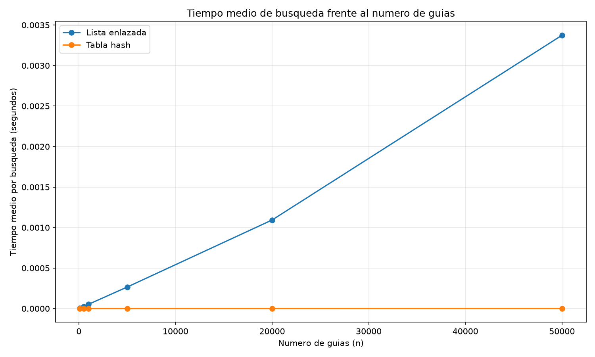
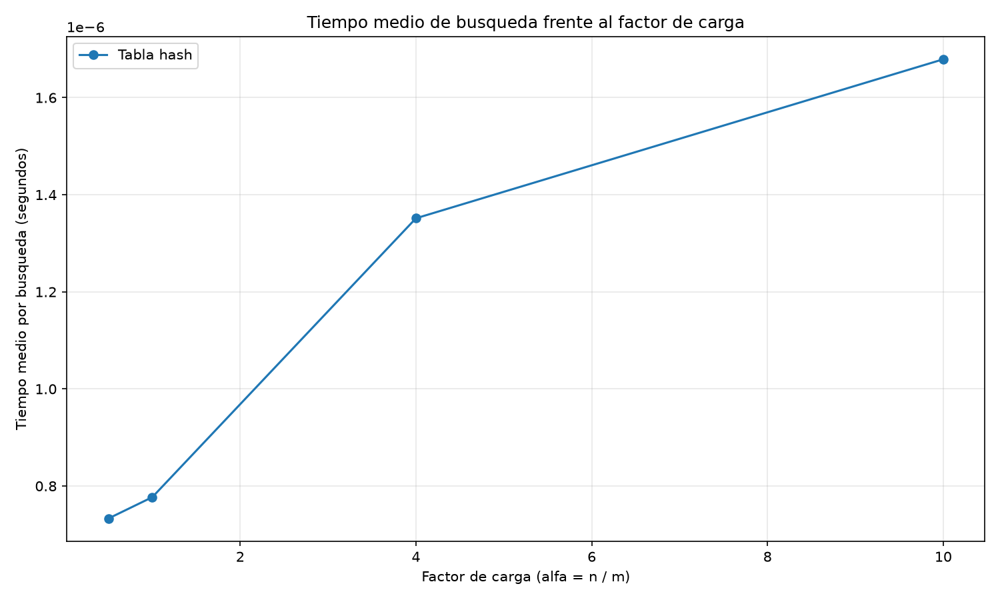

# Laboratorio evaluativo 03 — Estructuras de datos

**Estudiante:** [Esneider Guisao Ospina]

## Instrucciones para reproducir el experimento

Este laboratorio implementa una lista enlazada y una tabla hash con encadenamiento para consultar el estado de guías de envío de la empresa Rutas del Caribe.

Desde la raíz del repositorio, active el entorno virtual:

```cmd
.venv\Scripts\activate
```

Ingrese a la carpeta del laboratorio:

```cmd
cd lab3-estructuras-datos
```

Ejecute las pruebas automatizadas:

```cmd
python pruebas.py
```

Ejecute las mediciones y genere las gráficas:

```cmd
python medicion.py
```

Se requiere Python 3.12 o compatible y Matplotlib instalado en el entorno virtual. La generación de los datos utiliza semillas fijas para facilitar la reproducción de los experimentos.

## Parte 1. Implementación y verificación

**Archivos utilizados:** [estructuras.py](estructuras.py) y [pruebas.py](pruebas.py).

Se implementaron dos estructuras de datos. La primera es una lista simplemente enlazada que permite insertar guías al inicio y buscarlas mediante un recorrido iterativo. La segunda es una tabla hash que utiliza el método de división para calcular los índices y listas enlazadas para resolver las colisiones mediante encadenamiento.

Las pruebas comprueban las búsquedas exitosas e infructuosas en ambas estructuras. También verifican la colisión de las guías 10, 24 y 17 en la casilla 3 cuando la tabla tiene siete casillas, que las tres guías puedan recuperarse correctamente, que la lista de esa casilla tenga tamaño 3 y que el factor de carga sea igual a 3/7.

Adicionalmente, se compararon ambas estructuras en veinte colecciones aleatorias. Para las guías existentes se comprobó que devolvieran el mismo estado, y para las inexistentes se verificó que ambas devolvieran `None`.

Todas las pruebas fueron superadas, incluyendo los casos de colisión y el cálculo del factor de carga.

## Parte 2. Medición experimental

**Archivo utilizado:** [medicion.py](medicion.py).

Los experimentos se ejecutaron utilizando semillas fijas y guías enteras de diez dígitos. Se empleó `time.perf_counter()` para medir el tiempo medio de búsqueda, sin incluir la construcción de las estructuras ni la generación de los datos en el intervalo cronometrado. Cada medición correspondió a 200 búsquedas de guías inexistentes.

### Experimento A. Lista enlazada frente a tabla hash

Se compararon las estructuras con 100, 500, 1.000, 5.000, 20.000 y 50.000 guías. Para cada tamaño se utilizó un número primo de casillas cercano a la mitad de la cantidad de guías, manteniendo el factor de carga aproximadamente en 2.



Los resultados obtenidos fueron:

| Número de guías | Casillas de la tabla | Factor de carga | Lista enlazada (s/búsqueda) | Tabla hash (s/búsqueda) |
|---:|---:|---:|---:|---:|
| 100 | 53 | 1,887 | 0,00000547 | 0,00000042 |
| 500 | 251 | 1,992 | 0,00002538 | 0,00000042 |
| 1.000 | 503 | 1,988 | 0,00005274 | 0,00000045 |
| 5.000 | 2.503 | 1,998 | 0,00026555 | 0,00000070 |
| 20.000 | 10.007 | 1,999 | 0,00109346 | 0,00000083 |
| 50.000 | 25.013 | 1,999 | 0,00337385 | 0,00000107 |

La tabla hash presentó un menor tiempo medio de búsqueda en todos los tamaños evaluados. Para 50.000 guías, la lista enlazada tardó 0,00337385 segundos por búsqueda, mientras que la tabla hash tardó 0,00000107 segundos. Esto muestra una diferencia importante entre ambas estructuras cuando aumenta la cantidad de datos.

### Experimento B. Efecto del factor de carga

Para este experimento se mantuvieron 20.000 guías y se construyeron tablas con factores de carga de 0,5, 1, 4 y 10. Se midieron 200 búsquedas de guías inexistentes en cada tabla.



Los resultados fueron:

| Factor de carga (α) | Tiempo medio de búsqueda (s/búsqueda) |
|---:|---:|
| 0,5 | 0,00000073 |
| 1 | 0,00000078 |
| 4 | 0,00000135 |
| 10 | 0,00000168 |

En las mediciones se observa que el tiempo medio aumenta cuando crece el factor de carga. Esto ocurre porque se almacenan más guías por casilla y, por tanto, aumenta la cantidad de elementos que puede ser necesario revisar durante una búsqueda.

## Parte 3. Análisis

### 1. Costo teórico

Cuando se busca una guía inexistente en una lista enlazada, es necesario recorrer todos sus nodos para confirmar que no aparece. Por eso, el tiempo de búsqueda crece proporcionalmente a la cantidad de guías y tiene complejidad Θ(n).

En una tabla hash con encadenamiento, primero se calcula la casilla y después se recorre la lista asociada. Si la función hash distribuye las claves de manera aproximadamente uniforme, el número esperado de elementos por casilla depende del factor de carga α = n/m. Bajo este supuesto, el costo promedio de búsqueda es Θ(1 + α). Si todas las guías cayeran en una misma casilla, la búsqueda podría degradarse a Θ(n), perdiendo la ventaja de la tabla hash.

### 2. Lo medido frente a lo esperado

Entre 5.000 y 20.000 guías, el tiempo de la lista enlazada pasó de 0,00026555 a 0,00109346 segundos por búsqueda. El tiempo se multiplicó aproximadamente por 4,12, mientras que la cantidad de guías se multiplicó por cuatro. Esto se aproxima al crecimiento lineal esperado para Θ(n).

En la tabla hash, el tiempo pasó de 0,00000070 a 0,00000083 segundos, aproximadamente 1,19 veces, mientras el factor de carga permaneció cerca de 2. Esto es coherente con un costo promedio cercano a Θ(1) cuando α se mantiene acotado. En el segundo experimento, el tiempo aumentó desde 0,00000073 segundos con α = 0,5 hasta 0,00000168 segundos con α = 10. La tendencia concuerda con Θ(1 + α), aunque las variaciones del entorno también influyen en mediciones tan pequeñas.

### 3. Explicación de las colisiones

Una colisión ocurre cuando dos guías diferentes producen el mismo índice mediante la función hash. Puede ocurrir incluso si hay más casillas que guías, porque muchas claves posibles deben asignarse a un número limitado de índices. En el experimento con m = 7, las guías 10, 24 y 17 producen el índice 3 y comparten la misma casilla.

Con encadenamiento, cada casilla contiene una lista que almacena las claves que llegan a ella. Su ventaja es que permite manejar colisiones y realizar inserciones sin buscar otra casilla libre; su costo es que las búsquedas pueden recorrer varios nodos. En direccionamiento abierto, todas las claves se almacenan dentro de la propia tabla y, cuando ocurre una colisión, se busca otra posición disponible mediante una estrategia de sondeo. Esto evita listas adicionales, pero puede generar agrupamiento y hace necesario encontrar casillas libres para insertar nuevos elementos.

### 4. Tabla hash o árbol de búsqueda

Una tabla hash no es adecuada para consultar todas las guías entre X y Y, porque organiza las claves según su índice hash y no según su valor numérico. Para responder un rango tendría que revisar toda la colección.

Un árbol binario de búsqueda permite mantener las claves ordenadas y recorrer las ramas pertinentes al intervalo. Sin embargo, si se insertan 400.000 guías ya ordenadas, una por una, en un árbol binario de búsqueda ordinario, este puede degenerarse en una cadena de 400.000 nodos. Su altura sería aproximadamente 400.000, y una búsqueda desfavorable podría requerir hasta unas 400.000 comparaciones. En un árbol equilibrado, la altura sería del orden de log₂(400.000), aproximadamente 19 niveles, lo que permite realizar búsquedas mucho más eficientes. Para obtener ese comportamiento se necesita mantener el árbol equilibrado.

### 5. Concepto para la jefa de operaciones

Para consultar el estado de una guía, recomendaría la tabla hash, porque los resultados muestran tiempos de búsqueda bajos cuando el factor de carga se mantiene controlado. Para monitorear rangos de guías, utilizaría un árbol de búsqueda equilibrado, porque permite recorrer los valores ordenadamente y localizar los límites del intervalo.

Para estimar el tiempo de búsqueda en una lista enlazada con cinco millones de envíos, se puede partir del resultado medido con 50.000 guías, que fue de 0,00337385 segundos por búsqueda. Como la búsqueda infructuosa recorre toda la lista, el tamaño aumenta cien veces y, bajo un supuesto de costo por nodo comparable, la estimación sería de aproximadamente 0,3374 segundos por búsqueda. Es una extrapolación teórica, no una medición real.

Para la tabla hash, si se conserva un factor de carga cercano a 2 aumentando proporcionalmente el número de casillas, el costo promedio esperado se mantiene aproximadamente constante. Como referencia, el tiempo medido con 50.000 guías fue de 0,00000107 segundos por búsqueda; el tiempo con cinco millones podría mantenerse en un orden similar bajo el supuesto de una distribución uniforme de las claves. Esta cifra también es una estimación, no una garantía, porque depende de la distribución de las guías, la memoria disponible y las características del equipo.
